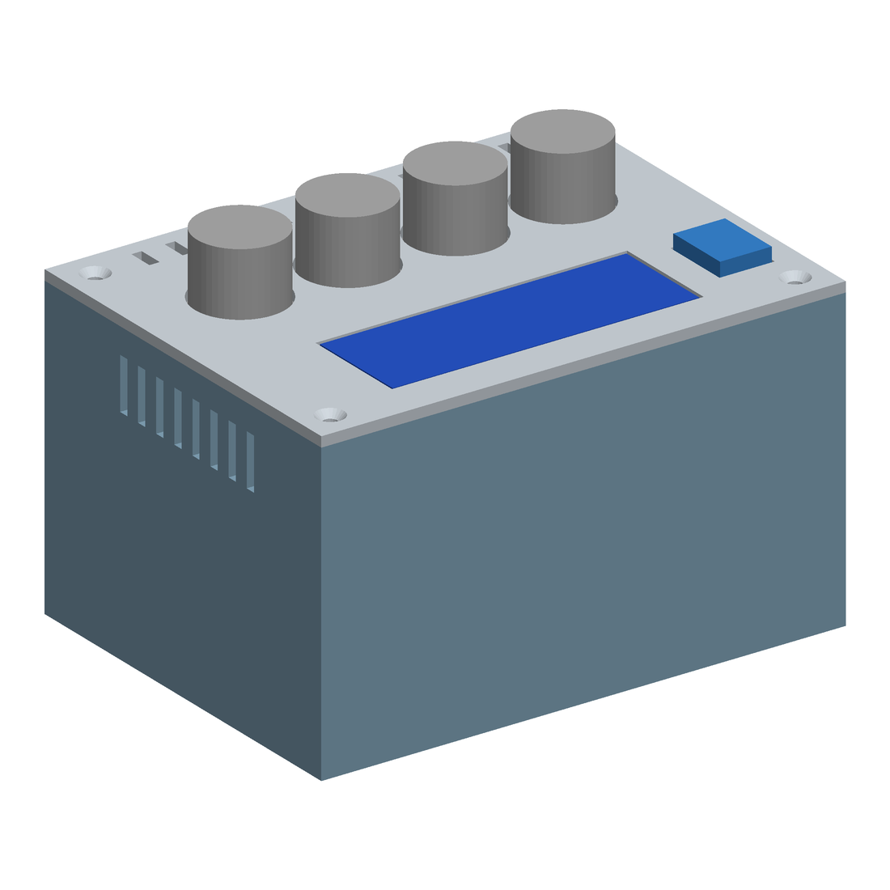
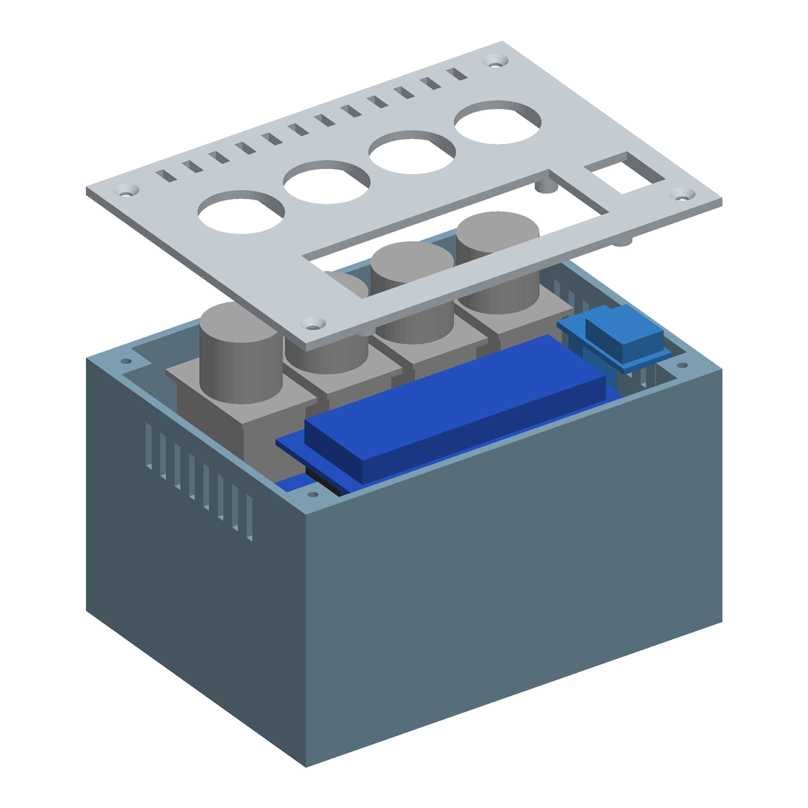
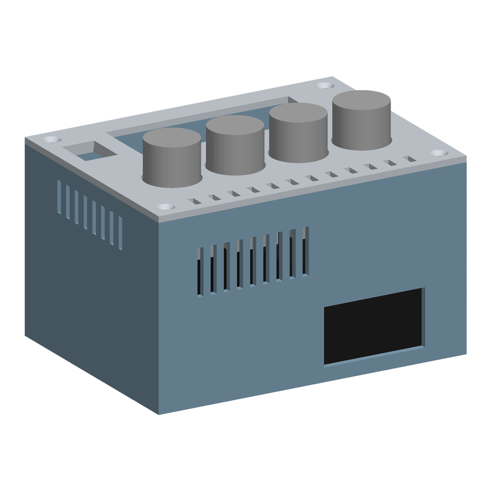

# Compact enclosure (Bambu Lab A1)

**Size:** 122 x 92 x 72 mm. That rises to about 95 mm tall once you count the feet and the MQ cans sticking up. It is roughly half the length and width of the clear storage box.

| Where | What |
|---|---|
| Lid | LCD (flush in a window), four MQ cans poking up, DHT11, exhaust slots |
| Floor | ESP32 on its expansion base, and the 40 mm fan blowing up through a grille |
| Back | One opening for USB and the power adapter plug, plus exhaust slits |

 

## Measure before you print

The part sizes are typical values, plus the expansion base estimated from a photo. Measure with a ruler, and if any of these differ, change the numbers at the top of `build_compact.mjs` and run `node enclosure/build_compact.mjs`. It rewrites the STL files and reports any collision.

| Part | Assumed (mm) | Setting |
|---|---|---|
| Expansion base with ESP32 and jumper wires standing up: length x width x height | 80 x 64 x 40 | `base` |
| MQ module board, and can height above the board | 32 x 22, can 20 wide, 17 tall | `mq` |
| Below each MQ board: pins plus jumper plugs | 22 | `mq.below` |
| Fan | 40 x 40 x 10.5, holes 32 apart | `fan` |
| LCD board, and its metal frame height | 80 x 36, frame 7 tall | `lcd` |

If you can, print only the lid first (about an hour). Check that the LCD, cans and DHT11 fit, then print the body.

## Print settings (Bambu Studio)

- **Filament:** PETG (Bambu PETG HF or Basic). PLA works indoors, but the MQ heaters warm the cans and PLA softens at about 55 °C. Use PETG if the box will sit near a window or in the sun.
- **Plate:** Textured PEI. On the smooth plate, use glue stick for PETG.
- **Settings:** 0.4 mm nozzle, 0.20 mm layers, 3 walls, 15% gyroid infill. **No supports**: every part is designed to print without them.
- **Orientation:** keep the files as they import.
  - `1_body.stl`: floor on the plate, open side up.
  - `2_lid.stl`: top face on the plate. The posts and rims point up.
  - `3_feet_x4.stl`: flat side down.
- All three files fit on one A1 plate (256 mm). Bambu Studio shows the real print time and grams. The body is the biggest part.

## Also needed

- 4 x M3 x 10 self-tapping screws, for the lid
- 4 x M3 x 16 screws and nuts for the fan (or the screws that came with it)
- 4 x M2.5 x 6 screws for the LCD
- Hot glue for the MQ and DHT11 boards
- A hook-and-loop pad under the expansion base
- Small cable ties for the jumper wires
- Optional: stick-on rubber feet (8 mm or taller) instead of the printed feet

## Assembly

1. Screw the fan under the floor grille, label side up, so it blows **into** the box. Push the feet into the floor holes.
2. Stick the expansion base between its four corner pins, with the USB and power plug facing the back opening.
3. Screw the LCD to the four lid posts, so its metal frame sits in the window.
4. Push each MQ can up through its hole and the DHT11 sensor through its slot. Each board drops into its rim. Add a dot of hot glue at the corners.
5. Plug the jumper wires in with the lid standing beside the box. Tie the spare length together on the empty side, next to the fan.
6. Close the lid and screw it down at the four corners.

Firmware updates now go over Wi-Fi (see `docs/OTA.md`), so the box never needs opening for code. USB is only needed for power.

## How the air moves

The box stands on feet. The fan pulls room air in through the floor, past the electronics, and out through the lid slots and wall slits. The gas sensors sit outside on the lid, so they smell room air rather than air inside the box. That keeps the readings honest and carries away the roughly 3 W of heat from the four MQ heaters.
